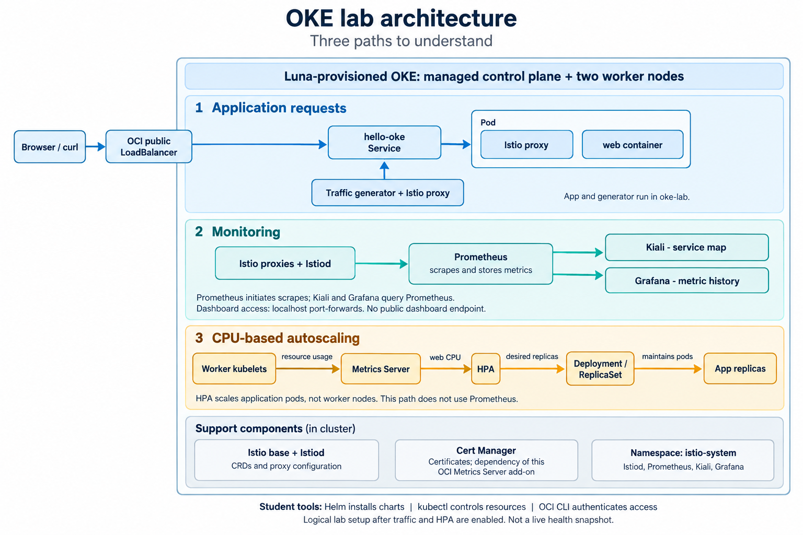

# OKE Bootcamp: Build, Run, and Scale Kubernetes on OCI

Deploy an application on Oracle Kubernetes Engine (OKE), watch its traffic in Kiali and Grafana, and scale it from two pods to four and back. You will use Helm to install the app, Istio to observe its traffic, and Prometheus to collect metrics.

Luna provides a fresh VM, provisions your cluster, and handles cleanup when the session ends.

This **60-minute hands-on lab and debrief** follows a 30-minute lecture while the cluster provisions (**90 minutes total**).

Your cluster has two **worker nodes**, the machines that run pods. Each application **pod** contains the Python app and an Istio proxy. A **Deployment** declares how many app pods should run, and its ReplicaSet maintains that count. A **Service** gives clients a stable way to reach those pods as individual pods change.

OKE manages the Kubernetes control plane. Istio uses the proxies to manage application traffic and report metrics.

This lab assumes you can navigate a terminal, copy commands, and edit a YAML value. By the end, you should be able to:

- Customize and deploy an application with Helm, then explain how its Service reaches its pods.
- Identify the application container and its Istio proxy, and follow traffic in Kiali.
- Interpret baseline traffic and compare Grafana readings during manual scaling.
- Scale app replicas manually and explain why this does not add worker nodes.
- Distinguish readiness from liveness and use pod events to investigate a health warning.

If time permits, use the **Horizontal Pod Autoscaler (HPA)** to adjust replicas from CPU measurements, or observe Kubernetes replacing a deleted pod. Neither extension is required to complete the lab.

Run commands in a **Bash terminal on the Luna desktop**. Keep session credentials private.

Materials revision: `lab-2026-09-30.4`. Your checkout and Luna instructions must show this same revision.

Record your results in the [completion sheet (PDF)](docs/completion-sheet.pdf) or [Markdown version](docs/completion-sheet.md). You can save or print the PDF.



Use the requests and monitoring panels for the core lab. The CPU-based autoscaling panel belongs to optional step 6. [View full-size](docs/images/oke-lab-architecture.png) or read the [component guide](docs/architecture.md).

## Schedule

| Approximate hands-on minutes | Exercise | What you will demonstrate |
|---|---|---|
| 0–10 | 1. Prepare your connection | Download lab files, connect to your cluster, and verify resource metrics |
| 10–28 | 2. Set up traffic monitoring | Install Istio, Prometheus, Kiali, and Grafana with Helm |
| 28–40 | 3. Configure and deploy | Customize and deploy two replicas with an OCI LoadBalancer |
| 40–48 | 4. Observe traffic | Interpret the Kiali graph and Grafana baseline |
| 48–55 | 5. Scale manually | Change app replicas from two to four and back to two |
| 55–60 | 8. Debrief and buffer | Explain your observations and absorb delays |

Complete steps 1–5, then go to step 8 for debrief. If you finish early, choose optional pod recovery (step 7, five minutes) or HPA (step 6, at least 15 minutes). Leave time to record your dashboard observations.

Times are provisional; a beginner pilot is still needed to validate them. Ask for help if downloads or cluster readiness delay your progress.

## Before hands-on: start preparation at the beginning of the lecture

Start the Luna lab when the lecture begins so the cluster can provision during the lecture.

## 1. Prepare and confirm your connection — 10 minutes

Use each code block's **Copy** button, then **Edit → Paste** in the Luna terminal (or **Ctrl+Shift+V**, not **Cmd+V**). If nothing pastes, see [Copy and paste in Luna](https://luna.oracle.com/lab/8f468598-9993-41b8-92ce-e643f5603f9b/steps#copy-and-paste-in-luna) in Appendix A.

In a **Bash terminal** on your Luna desktop, download the lab repository. Keep this window open as **terminal 1**:

```bash
git clone --branch lab-2026-09-30.4 --single-branch \
  https://github.com/chiphwang1/AI_world_lab.git "$HOME/oke-bootcamp" &&
  cd "$HOME/oke-bootcamp"
```

Git checks out a fixed release, so a `detached HEAD` notice is expected. Some Git versions also print a tag-related `not a commit` warning before completing checkout. Continue when cloning finishes and your terminal is in `oke-bootcamp`; you do not need to create a branch. If Git prints `fatal:` or cloning does not finish, stop and ask the instructor.

### Find your lab login and compartment

Sign in with your temporary Luna account:

1. Double-click **Luna-Lab** (or **Luna Lab**) on the desktop. Keep this session-information page open.
2. Under **Quick Links**, click **OCI Console** to open the sign-in tab.
3. Copy your assigned username and password from **Credentials** into **User Name** and **Password**. **Do not use the SSO Link.**
4. Paste with **Ctrl+V** or right-click **Paste**, then click **Sign In**.
5. Return to Luna Lab and note your **Compartment Name** and **region** under **Lab Details** (or the **Oracle Cloud** section). Use these to select your cluster.

If session details are missing, stop and ask the instructor; do not use a personal account or another learner's credentials. See [Oracle's Luna login instructions](https://docs.oracle.com/en/learn/build-cloud-native-java-applications-with-micronaut-and-graalvm/lab1/configure-db-access.html); its database exercises do not apply here.

### Open your own cluster in the OCI Console

Use the assigned compartment and region shown in Luna Lab.

Your **kubeconfig** tells kubectl which cluster to connect to and how to authenticate. Create it at `~/.kube/config` on your Luna desktop—the default location used by kubectl and Helm. Follow the Console route below; the [access guide](docs/cluster-access.md) is for additional authentication details or troubleshooting.

1. Select your **region** in the OCI Console. Open the upper-left navigation menu → **Developer Services → Containers & Artifacts → Kubernetes Clusters (OKE)**. See [Oracle's navigation instructions](https://docs.oracle.com/en-us/iaas/Content/ContEng/Tasks/list-clusters.htm).
2. Open the **Compartment** filter. Expand the compartment hierarchy if needed and select the exact **Compartment Name** shown on your Luna Lab page. Do not choose a compartment just because its name begins with `luna`, and do not use the tenancy root.
3. Open the cluster Luna created for you. If it is still provisioning, wait until it is ready.
4. On your cluster's details page, select **Access Cluster** (under **Actions** if necessary), then **Local Access**. Select **Public Endpoint**. For this lab, run the commands below in the Bash terminal on your Luna VM.
5. In **terminal 1**, follow the **Local Access** instructions and run the displayed commands in order, including `oci ce cluster create-kubeconfig`. Keep the default kubeconfig location (`~/.kube/config`).

Luna provides a fresh VM for this lab. The command creates `~/.kube/config` and selects your cluster. All terminals on this VM use that file automatically.

### Check cluster readiness

In terminal 1, run preflight from the repository root:

```bash
bash scripts/check-ready.sh
```

This read-only check verifies your tools, cluster connection, two Ready workers, and CPU/memory metrics.

Expect these lines and numeric CPU/memory readings (values vary):

```text
PASS Workers: 2/2 Ready and not cordoned
PASS Resource metrics: numeric CPU and memory for both workers
```

Continue only after `Preflight passed`. On `FAIL`, follow its message or ask the instructor; see [preflight troubleshooting](https://luna.oracle.com/lab/8f468598-9993-41b8-92ce-e643f5603f9b/steps#preflight-fails).

### Download the Helm charts

A **Helm chart** is a package of instructions for installing software in Kubernetes. Before installing anything, download the five pinned Helm charts used in this lab: Istio base, Istiod, Prometheus, Kiali, and Grafana. These steps only prepare files on your Luna VM; they do not change the cluster.

Run each command below in **terminal 1**, from the `oke-bootcamp` directory. Wait for each command to finish before moving on. If you see an error or `FAIL`, stop and follow the message or ask the instructor.

**1. Load the lab's version settings into this terminal.**

`helm/versions.env` is a text file included in your lab download. The following settings are already in the file; this table is for reference:

| Setting | Chart version |
|---|---|
| `ISTIO_VERSION` | `1.31.0` |
| `PROMETHEUS_CHART_VERSION` | `29.30.0` |
| `KIALI_CHART_VERSION` | `2.32.0` |
| `GRAFANA_CHART_VERSION` | `13.2.5` |

These versions are **pinned**, meaning everyone uses the same selected versions. Istio's two charts, `base` and `istiod`, share `ISTIO_VERSION`, so four settings cover all five charts. Leave these settings unchanged.

Run this command to load the file's settings into your current terminal:

```bash
source helm/versions.env
```

`source` makes each setting available as a shell variable. Later, the terminal replaces `${ISTIO_VERSION}` with `1.31.0`; for example, `base-${ISTIO_VERSION}.tgz` becomes `base-1.31.0.tgz`.

**This command does not download or install anything.** It normally prints nothing and returns to the prompt. Keep terminal 1 open so these settings remain available for the installation commands.

**2. Download the five charts.**

This script downloads the selected versions and saves them in `.lab-cache/charts/` inside your lab directory. It also checks each downloaded chart's name and version.

```bash
bash scripts/prepare-charts.sh --download
```

Expect five `PASS Prepared chart` lines, one for each chart.

**3. Confirm the files are ready to install.**

This checks the five saved charts again without downloading anything. It confirms that each file can be read and matches the lab's expected name and version.

```bash
bash scripts/prepare-charts.sh --check
```

Continue after five `PASS Prepared chart` lines and `Chart archives match helm/versions.env.` You will install these charts in step 2 of the lab.

### Confirm your prepared connection

After preflight and all five chart checks pass, inspect the workers and their resource usage in terminal 1:

```bash
kubectl get nodes
kubectl top nodes
```

Expect two `Ready` workers and numeric CPU/memory readings. Keep terminal 1 open for later commands.

**Before continuing:** confirm that both workers show `Ready` and have numeric CPU/memory readings.

Metrics Server supplies the CPU/memory readings in `kubectl top`. Prometheus, installed next, supplies the dashboard metrics.

## 2. Set up traffic monitoring for your application — 18 minutes

In step 1, you downloaded installation files. Now you will use Helm to install the tools **in your cluster**. Install them now so they are ready to observe the application when it starts in step 3.

Use **terminal 1**, still in the `oke-bootcamp` directory. Run the command blocks below in order, one block at a time. Each installation can take a few minutes.

### What you will install

| Order | Tool | What it does |
|---|---|---|
| 1 | Istio | Adds a proxy beside each app container to handle traffic and report request metrics. It needs two charts: `base` and `istiod`. |
| 2 | Prometheus | Collects and stores those metrics. |
| 3 | Kiali | Uses Prometheus metrics to show a map of traffic between services. |
| 4 | Grafana | Uses Prometheus metrics to show charts of request rate, errors, and response time. |

Install Istio first, then Prometheus, then the two dashboards. You will open the dashboards in step 4, after the app is sending traffic.

Helm, `kubectl`, and OCI CLI are already installed on the Luna VM. Metrics Server and Cert Manager are already provided with the cluster. The HPA is an optional exercise in step 6; it is not part of this installation.

These are upstream open-source tools; we do not modify their application source code. The repository provides lab-specific settings and a Grafana dashboard. The `hello-oke` app and its chart are custom training materials.

A **namespace** groups resources: monitoring uses `istio-system`; the app uses `oke-lab`. Select it with Helm's `--namespace` or kubectl's `-n`.

### Install Istio

Istio uses **sidecar mode**, adding a proxy beside each app container.

Each Helm command installs one downloaded chart as a named **release**. For example, the first command installs the `base` chart as the release `istio-base`.

The commands use the same options:

- `upgrade --install`: install the release, or update it if it already exists.
- `--namespace istio-system`: put the resources in the group reserved for these tools.
- `-f`: read the supplied lab settings from a YAML file.
- `--wait --timeout 10m`: wait up to ten minutes for the release to become ready.

Copy each complete command block, including its continuation lines. The version variables, such as `${ISTIO_VERSION}`, were loaded in step 1; leave them as written.

**After each Helm command:** wait for `STATUS: deployed` and the command prompt to return before running the next block. A successful install may take a few minutes while the workers download container images.

You may see `Warning:` messages about replica counts, resource settings, or pod placement. These can be advisory messages from the cluster. Continue only when Helm reports `STATUS: deployed` and the readiness checks below pass. If Helm reports `Error:`, a failed installation, or a timeout, stop and ask the instructor.

**1. Install Istio's resource definitions.**

This command installs the custom resource definitions (CRDs) that Kubernetes needs to recognize Istio configuration objects. It also creates the `istio-system` namespace, where you will install Istio and the monitoring tools.

Install these definitions first; the next command installs `istiod`, which manages the application proxies.

```bash
helm upgrade --install istio-base ".lab-cache/charts/base-${ISTIO_VERSION}.tgz" \
  --namespace istio-system --create-namespace \
  --set defaultRevision=default --wait --timeout 10m
```

**2. Install the Istio control plane.**

Install `istiod`, which configures the proxies that run alongside your application containers. The `-f` option loads the lab's settings from `helm/values/istiod.yaml`.

```bash
helm upgrade --install istiod ".lab-cache/charts/istiod-${ISTIO_VERSION}.tgz" \
  --namespace istio-system \
  -f helm/values/istiod.yaml --wait --timeout 10m
```

**3. Confirm the control plane is ready.**

This command waits for the `istiod` Deployment to finish starting. Continue when it reports `deployment "istiod" successfully rolled out`.

```bash
kubectl -n istio-system rollout status deployment/istiod --timeout=300s
```

**4. Prepare a namespace for your application.**

The first command creates `oke-lab`, a separate namespace for the app. The second enables automatic proxy injection: Istio will add a proxy to each **new app pod** created there. You will deploy those pods in step 3 of the lab.

```bash
kubectl create namespace oke-lab
kubectl label namespace oke-lab istio-injection=enabled
```

Expect confirmation that `oke-lab` was created and labeled. On the [architecture diagram](docs/architecture.md), locate the app and its proxy, then trace how their metrics reach the monitoring tools you will install next.

### Install Prometheus

Prometheus periodically reads metrics from components; this collection is called **scraping**. It stores metrics temporarily; replacing its pod loses metric history.

```bash
helm upgrade --install prometheus ".lab-cache/charts/prometheus-${PROMETHEUS_CHART_VERSION}.tgz" \
  --namespace istio-system \
  -f helm/values/prometheus.yaml --wait --timeout 10m
```

Success: Helm reports `STATUS: deployed`. Prometheus is now installed; application traffic metrics will appear after you deploy the app and start the traffic generator in step 3.

### Install Kiali

This installs the Kiali dashboard. The supplied values file tells Kiali where to find Prometheus, so it can turn request metrics into a traffic map.

```bash
helm upgrade --install kiali-server ".lab-cache/charts/kiali-server-${KIALI_CHART_VERSION}.tgz" \
  --namespace istio-system \
  -f helm/values/kiali.yaml --wait --timeout 10m
```

Success: Helm reports `STATUS: deployed`. Leave Kiali installed for now; you will open it in step 4.

### Install Grafana

This installs Grafana and loads the lab's ready-made dashboard. The `--set-file` option supplies that dashboard from `helm/dashboards/oke-lab.json`; the values file connects Grafana to Prometheus.

```bash
helm upgrade --install grafana ".lab-cache/charts/grafana-${GRAFANA_CHART_VERSION}.tgz" \
  --namespace istio-system \
  -f helm/values/grafana.yaml \
  --set-file dashboards.default.oke-lab.json=helm/dashboards/oke-lab.json \
  --wait --timeout 10m
```

Success: Helm reports `STATUS: deployed`.

### Check that all tools are ready

All five tool releases were installed in the `istio-system` namespace: Istio base, Istiod, Prometheus, Kiali, and Grafana. Despite its name, this namespace contains the entire monitoring setup, so the commands below check all of these tools, not just Istio. The application will be installed and checked separately in `oke-lab` in step 3.

**1. List the Helm installations.**

```bash
helm list --namespace istio-system
```

Expect these five release names, each with `STATUS` set to `deployed`: `istio-base`, `istiod`, `prometheus`, `kiali-server`, and `grafana`. There are five releases because Istio uses two charts.

**2. Check the running pods.**

```bash
kubectl -n istio-system get pods
```

For each running pod, the `READY` column should have matching numbers, such as `1/1`, and `STATUS` should be `Running`. Pod names and counts vary by component; `istio-base` installs definitions and does not have its own pod. If a pod is still starting, wait 30 seconds and run the command again. Ask the instructor if it remains unready or shows an error.

Kiali and Grafana use anonymous Viewer access through local port-forwards in step 4. Keep their Services internal; use the supplied dashboard URLs when you reach that step.

**Before continuing:** confirm that all five Helm releases show `deployed` and all running pods are ready.

## 3. Configure and deploy the application — 12 minutes

Helm creates the app's **Deployment** and **Service** from the app chart; Kubernetes creates each **Pod** replica from the Deployment's template. You'll inspect these objects after installation.

The **values file** `helm/values/student.yaml` contains the app settings. Its `message` becomes the app's `APP_MESSAGE` environment variable and the text returned to your browser.

From the repository root, open `helm/values/student.yaml` in your preferred desktop editor, or use Vim in terminal 1:

```bash
vim helm/values/student.yaml
```

In Vim, press `i` to edit. Change only `message`, for example:

```yaml
message: "Hello from YOUR-NAME's OKE lab"
```

Replace `YOUR-NAME` and leave replicas and resource settings unchanged. In Vim, press `Esc`, type `:wq`, and press Enter to save and exit. Saving the file does not change the cluster; the Helm command below applies it. The chart supplies Python code and uses a published Python runtime image, so you do not build an image or need an image registry account.

The app chart creates a Deployment with two replicas, a ConfigMap holding the Python application code, and a LoadBalancer Service. Istio adds the proxy to each new pod. The traffic generator and HPA are disabled initially; you enable them later.

**Check your settings.** `helm lint` checks the chart and values without deploying anything.

```bash
helm lint ./charts/oke-mesh-app -f helm/values/student.yaml --strict
```

Continue when it reports `0 chart(s) failed`. An icon recommendation is informational.

**Deploy the app.** Helm installs `hello-oke` in `oke-lab` using your values file and waits for readiness:

```bash
helm upgrade --install hello-oke ./charts/oke-mesh-app \
  --namespace oke-lab -f helm/values/student.yaml --wait --timeout 10m
```

**Inspect the result.** Nodes, pods, and containers are different levels of the application:

1. **Worker nodes** are the machines running your workloads:

   ```bash
   kubectl get nodes
   ```

   Expect two rows with `STATUS: Ready`.

2. **The app Deployment** declares the desired number of app pods:

   ```bash
   kubectl -n oke-lab get deployment hello-oke
   ```

   `READY 2/2` means **2 ready pods / 2 desired pods**.

3. **Each app pod** contains the app and its Istio proxy:

   ```bash
   kubectl -n oke-lab get pods -l app=hello-oke
   ```

   Expect two pod rows with `STATUS: Running`. Each row's `READY 2/2` means **2 ready containers / 2 containers in that pod**: `web` (the app) and `istio-proxy` (the proxy).

Kubernetes chooses which worker runs each pod. Two app pods do not guarantee one pod per worker.

For optional container inspection or troubleshooting, see [Appendix B](https://luna.oracle.com/lab/8f468598-9993-41b8-92ce-e643f5603f9b/steps#appendix-b-optional-pod-inspection).

The Service requests an OCI LoadBalancer so you can reach the app from a browser. Display its public address:

```bash
kubectl -n oke-lab get svc hello-oke
```

Wait until `EXTERNAL-IP` contains an address. If it shows `<pending>`, wait 30 seconds and repeat the command; ask for help after three minutes.

Save that address for later commands:

```bash
APP_IP=$(kubectl -n oke-lab get svc hello-oke -o jsonpath='{.status.loadBalancer.ingress[0].ip}')
echo "$APP_IP"
```

`-o jsonpath=...` extracts the IP; `$(...)` saves the result in `APP_IP`. `echo` should print the address. This variable is available only in this terminal; later commands reuse it as `${APP_IP}`.

Test the application in the same terminal:

```bash
curl --fail --max-time 10 "http://${APP_IP}/"
```

Expected response (illustrative; your message and pod name will differ):

```json
{"message":"Hello from YOUR-NAME's OKE lab","pod":"hello-oke-example-abc12","work":false}
```

Open `http://<EXTERNAL-IP>/` in the Luna browser to see the same response. Use **HTTP, not HTTPS**. If the first request fails, wait 15–30 seconds and retry; ask for help after a minute. Use only training data in this public app.

A **traffic generator** automatically sends test requests to your application, so you do not have to keep refreshing a browser.

In this lab, it runs as a separate Deployment with one pod. Its `traffic` container sends an HTTP request to the `hello-oke` Service about every two seconds. The Service routes each request to an application pod.

These requests provide activity to observe: **Kiali shows the traffic between the generator and the application, while Grafana charts request rate, response time, and errors.** The generator runs inside the cluster and uses the Service's internal address rather than the public LoadBalancer address.

**Start baseline traffic.** `--reuse-values` keeps your existing release settings, including your message. `--set traffic.enabled=true` starts the generator:

```bash
helm upgrade hello-oke ./charts/oke-mesh-app --namespace oke-lab \
  --reuse-values --set traffic.enabled=true --wait --timeout 10m
```

Check the generator pod and the responses it receives:

```bash
kubectl -n oke-lab get pods -l app=hello-oke-traffic
kubectl -n oke-lab logs -l app=hello-oke-traffic -c traffic --prefix --timestamps --tail=10
```

Expect one generator pod showing `2/2 Running`. `-l` selects that pod and `-c traffic` selects its request-sending container. The logs are a snapshot of the last ten responses. Each response's `pod` field identifies an application pod, not the generator. Leave it running to supply dashboard traffic.

For optional details such as container state, restart counts, and events, see [traffic-generator inspection in Appendix B](https://luna.oracle.com/lab/8f468598-9993-41b8-92ce-e643f5603f9b/steps#traffic-generator-pod).

**Before continuing:** confirm that your message appears in the HTTP response, two app pods show `2/2 Running`, and the traffic-generator pod is running.

## 4. Explore traffic in Kiali and Grafana — 8 minutes

Kiali and Grafana run inside your Kubernetes cluster and have no public web address. To open them, you will use **port-forwarding**: `kubectl` creates a temporary connection from a port on your Luna VM to a dashboard inside the cluster.

For example, the Kiali command below connects port `20001` on your Luna VM to Kiali's port `20001` in the cluster. Opening `http://localhost:20001/kiali` sends your browser request through that connection. **`localhost` means the computer running the browser**, so open this URL in the **Luna VM's browser**.

**Prepare your terminal windows on the Luna desktop:**

1. Keep your existing terminal open. This is **terminal 1**, where you ran the earlier lab commands. Return to it for scaling in step 5.
2. Open another terminal window. This is **terminal 2**; run only the Kiali command below in it.
3. Open one more terminal window. This is **terminal 3**; run only the Grafana command below in it.

These numbers are labels for this lab; you do not need to rename the windows. All three terminals use the `~/.kube/config` created in step 1, so no setup commands or directory changes are needed in the new windows.

**Leave terminals 2 and 3 open while using the dashboards.** A port-forward command keeps running and does not return to the command prompt; this is normal. Closing its terminal or pressing **Ctrl+C** stops that connection, and the corresponding dashboard becomes unavailable until you run the command again. You can switch windows while it runs.

### Kiali: service-to-service traffic

In **terminal 2** on the same Luna desktop:

```bash
kubectl -n istio-system port-forward --address 127.0.0.1 svc/kiali 20001:20001
```

1. Wait for `Forwarding from 127.0.0.1:20001` and leave this terminal running.
2. Open **http://localhost:20001/kiali** in the **Luna VM's browser**. The port-forward is running on that VM.
3. Select `oke-lab`, open the traffic graph, choose **Last 5 minutes**, and enable refresh.
4. Allow 1–2 minutes for metrics, then find `hello-oke-traffic → hello-oke`. Inspect its request rate, success rate, and latency.

If Kiali shows **Degraded**, see [Kiali health warnings in Appendix A](https://luna.oracle.com/lab/8f468598-9993-41b8-92ce-e643f5603f9b/steps#kiali-health-warnings).

### Grafana: metrics over time

Leave the Kiali port-forward running. In **terminal 3** on the same desktop:

```bash
kubectl -n istio-system port-forward --address 127.0.0.1 svc/grafana 13000:80
```

1. Wait for `Forwarding from 127.0.0.1:13000` and leave this terminal running.
2. Open **http://127.0.0.1:13000/d/oke-lab** in the **Luna VM's browser**. Viewer access needs no login.
3. If the page fails to open or the port is already in use, follow [port-forward troubleshooting](https://luna.oracle.com/lab/8f468598-9993-41b8-92ce-e643f5603f9b/steps#troubleshooting-dashboard-port-forwards).

The **OKE Lab — Traffic & Scaling** dashboard uses a 30-minute range and refreshes every 15 seconds. The generator sends one request every two seconds. Compare that with these baseline readings:

- **Requests / second:** the average request rate over the last minute. Expect about 0.5 (one request every two seconds).
- **Successful requests:** the percentage of requests with HTTP 2xx/3xx responses. Expect near 100% for healthy traffic.
- **Request latency, p95:** estimated response time at the 95th percentile. A p95 of 100 ms means about 95% of requests finished within 100 ms. Record p95, not the average or p50.
- **Application proxies up:** two successfully scraped application proxies, excluding the generator.
- **Istiod scrape health:** `1` means Prometheus can scrape Istiod; this is not a complete control-plane health check.
- **Traffic, latency, response codes, and proxy-count graphs:** history to compare during manual scaling and, optionally, the HPA load burst.

To read p95, scroll to **Request latency** and hover over a recent point. Record the tooltip's **p95** value and timestamp in your notes, not p50.

**Proxy count is not pod readiness**; scrape discovery can lag. Confirm two Ready pods with `kubectl -n oke-lab get pods -l app=hello-oke`. HPA remains disabled throughout the core lab. Empty panels mean `no data`, not zero traffic or health ([troubleshooting](docs/troubleshooting.md)).

**Before continuing:** confirm that Kiali shows `hello-oke-traffic → hello-oke` and Grafana displays traffic data. Record the baseline readings in your [completion sheet (PDF)](docs/completion-sheet.pdf).

Keep both dashboards open for scaling. Use the same Grafana time range and p95 statistic for each observation. The generator continues sending about one request every two seconds even when you add replicas.

Ask for help if panels remain empty after two minutes of traffic.

## 5. Scale manually — 7 minutes

Return to **terminal 1 at the repository root**, using your verified lab context; leave both port-forwards running. For a new terminal, see [fresh-terminal setup in Appendix A](https://luna.oracle.com/lab/8f468598-9993-41b8-92ce-e643f5603f9b/steps#fresh-terminal-setup-errors).

Kubernetes continually works toward **desired state**. Setting `replicaCount=4` asks for four app pods; the Deployment's ReplicaSet creates the additional pods needed to reach that count.

**Increase the app to four pods, then wait for the change to finish.**

The first command updates the existing Helm release. Here is what each part does:

| Command part | Meaning |
|---|---|
| `helm upgrade hello-oke` | Update the installed application named `hello-oke`. |
| `./charts/oke-mesh-app` | Use the application chart from your lab download. |
| `--namespace oke-lab` | Update the application in the `oke-lab` namespace. |
| `--reuse-values` | Keep your existing settings, including your message and the traffic generator. |
| `--set replicaCount=4` | Set the desired total to four application pods. |
| `--wait --timeout 10m` | Wait up to ten minutes for Helm's readiness checks. |

The second command, `kubectl ... rollout status`, waits for Kubernetes to finish updating the `hello-oke` Deployment. Its `--timeout=300s` allows up to five minutes for this check.

Run both commands in terminal 1:

```bash
helm upgrade hello-oke ./charts/oke-mesh-app --namespace oke-lab \
  --reuse-values --set replicaCount=4 --wait --timeout 10m
kubectl -n oke-lab rollout status deployment/hello-oke --timeout=300s
```

Continue when you see `deployment "hello-oke" successfully rolled out`. Helm can report `deployed` before every desired replica is ready; the rollout check waits for the Deployment to finish. If either command reports an error or timeout, stop and ask the instructor.

You should now have four ready application pods. These commands do not add worker nodes or change the number of traffic-generator pods.

**Inspect the change.** `-o wide` adds the worker name for each pod. The other commands show ready app replicas, worker nodes, and the Service IP:

```bash
kubectl -n oke-lab get pods -l app=hello-oke -o wide
kubectl -n oke-lab get deployment hello-oke
kubectl get nodes
kubectl -n oke-lab get svc hello-oke
```

**Check that the app still responds.** This loop sends ten requests; compare the `pod` names in the responses:

```bash
for request in {1..10}; do curl --fail --max-time 10 "http://${APP_IP}/"; done
```

**Check the scaling result**

You increased the application from two pods to four. You should now see:

- **Four application pods**, each showing `2/2` in the `READY` column.
- **Two worker nodes**—scaling the application creates more pods on the existing machines.
- **The same Service IP**—clients continue using the same address even as the number of pods changes.

The `NODE` column shows which worker hosts each pod. Kubernetes chooses placement based on scheduling rules and available resources, so the pods may not be divided evenly between the workers.

Your ten test requests confirm that the application still responds. Compare the pod names in the responses, but do not expect every pod to appear equally often in such a small sample. These extra requests may briefly increase Grafana's request-rate reading.

Record the results on your completion sheet.

**Understand whether a pod is ready**

`Running` means the pod has started running; it does **not** guarantee that every container is ready to serve traffic.

Each application pod contains two containers: `web` and `istio-proxy`. A `READY` value of `2/2` means both are ready.

Kubernetes uses **probes**, or automatic health checks, to decide whether a container can receive traffic or needs restarting:

| Probe | What it checks | What happens after repeated failures |
|---|---|---|
| **Readiness** | Can this container accept traffic? | Kubernetes marks the pod unready and stops sending normal Service traffic to it. This check does not restart the container. |
| **Liveness** | Is this container still functioning? | Kubernetes restarts the failing container. |

The lab's web application answers both checks at `/healthz`. Its liveness checks begin after a ten-second initial delay.

Use `READY` to check traffic readiness and `RESTARTS` to spot container restarts. A pod can show `Running`, an incomplete ready count, and zero restarts while a container is starting or failing its readiness checks. See the [Kubernetes probe guide](https://kubernetes.io/docs/concepts/workloads/pods/probes/) for more detail.

Restore the starting size, then confirm the result:

```bash
helm upgrade hello-oke ./charts/oke-mesh-app --namespace oke-lab \
  --reuse-values --set replicaCount=2 --wait --timeout 10m
kubectl -n oke-lab rollout status deployment/hello-oke --timeout=300s
kubectl -n oke-lab get pods -l app=hello-oke
```

Pods being removed may briefly show `Terminating`; wait for those rows to disappear before recording the restored count.

**Before continuing:** confirm two Ready app pods, unchanged Service IP, and two workers. Record the restored row on your completion sheet. Go to **step 8** to finish, or choose an optional extension if time permits.

## 6. Optional: CPU-based autoscaling — allow at least 15 minutes

Start only after step 5 is complete and at least 15 minutes remain before debrief (by lab minute 40). Otherwise skip to step 8 or save this extension for a follow-up session. Keep the dashboards open and use terminal 1. The estimate includes setup, a five-minute burst, and scale-in; it is not a guarantee. If time runs short, reset the load using **Stop load and observe scale-in** below and record any unfinished observations.

Use the completion sheet's **optional HPA** sections. Skipping this extension does not affect core completion.

### Enable CPU autoscaling

Check worker and per-container CPU/memory readings:

```bash
kubectl top nodes
kubectl -n oke-lab top pods --containers
```

Expect numeric readings in the CPU and memory columns. If metrics are unavailable, stop here and ask the instructor to check Metrics Server. **The Prometheus used by Kiali and Grafana does not supply this HPA's CPU metrics.**

The HPA chooses the desired pod count from CPU measurements. Enable it first:

```bash
helm upgrade hello-oke ./charts/oke-mesh-app --namespace oke-lab \
  --reuse-values --set autoscaling.enabled=true --wait --timeout 10m
```

Inspect its target and conditions:

```bash
kubectl -n oke-lab get hpa hello-oke
kubectl -n oke-lab describe hpa hello-oke
```

Expected `get hpa` output once baseline metrics are available (illustrative; age and CPU vary):

```text
NAME        REFERENCE              TARGETS       MINPODS   MAXPODS   REPLICAS   AGE
hello-oke   Deployment/hello-oke    cpu: 1%/60%   2         6         2          1m
```

Read the output as follows:

- `MINPODS 2` and `MAXPODS 6`: HPA can run **2–6 application pods**.
- `TARGETS 1%/60%`: current average utilization / target utilization for the `web` container.
- The target is 60% of the app's `100m` CPU request, or `60m` per pod. `100m` is one tenth of a CPU.
- The Istio proxy's CPU is excluded. The app's `250m` limit caps its CPU use.

Metrics Server supplies this HPA's CPU measurements. Grafana displays dashboard metrics and does not control the replica count.

The first HPA output may show `<unknown>` for CPU while measurements become available. The replica count may also briefly drop below two as Helm hands control to the HPA. Wait 30 seconds, then rerun the two HPA checks above.

Continue only when utilization is numeric, `ScalingActive=True`, and the app has two Ready replicas. Ask for help after two minutes without metrics. Do not manually scale while the HPA controls replicas.

Keep the lab's resource settings unchanged. Record the HPA baseline row before enabling load.

### Generate a five-minute CPU load

The `/work` endpoint performs CPU-intensive calculations before responding. Requests to it create CPU demand in the application pods; the HPA uses the resulting CPU measurements to decide whether to add replicas. Heavier requests do not necessarily mean more requests per second, so use app CPU to explain the scaling response.

The generator sends two concurrent streams to `/work` for five minutes, then returns to low-rate `/` traffic:

```bash
helm upgrade hello-oke ./charts/oke-mesh-app --namespace oke-lab \
  --reuse-values --set traffic.loadEnabled=true --wait --timeout 10m
```

Watch CPU utilization and replica changes for several minutes:

```bash
kubectl -n oke-lab get hpa hello-oke --watch
```

To inspect CPU and logs, press Ctrl+C in **terminal 1** to stop only the watch, then run the checks below. If the shortcut does not reach Luna, use the [terminal interrupt fallback](https://luna.oracle.com/lab/8f468598-9993-41b8-92ce-e643f5603f9b/steps#if-ctrlc-does-not-reach-the-terminal).

```bash
kubectl -n oke-lab top pods --containers
kubectl -n oke-lab get pods -l app=hello-oke -o wide
kubectl -n oke-lab logs -l app=hello-oke-traffic -c traffic --prefix --timestamps --tail=10
```

Resume `kubectl -n oke-lab get hpa hello-oke --watch` as needed. After five minutes, the generator logs show **“CPU load finished; returning to baseline traffic.”** This means the generator has resumed its usual requests to `/`. Prefixes and timestamps distinguish old and new generator pods during rollouts. Leave dashboard forwards running.

Even after that message appears, run the load-reset command below to save burst mode as disabled.

Watch Grafana's **Traffic through Istio**, **Request latency**, and **Application proxy count — scaling indicator** alongside the HPA. Record load readings, peak replicas, and success/response codes; check the Kiali traffic edge. Six replicas is a limit, not a guaranteed peak. For Pending pods or `<unknown>` CPU, use [troubleshooting](docs/troubleshooting.md); do not enlarge the node pool.

Baseline `/` and burst `/work` do different work; two concurrent streams produce a variable request rate. Because both workload and replicas change, this comparison cannot isolate autoscaling's effect on latency.

Use one baseline reading and one load reading to compare request rate, p95 latency, and replicas. Record these readings and app CPU in the optional HPA table.

### Stop load and observe scale-in

Explicitly reset burst mode after the test (this also stops an active burst early):

```bash
helm upgrade hello-oke ./charts/oke-mesh-app --namespace oke-lab \
  --reuse-values --set traffic.loadEnabled=false --wait --timeout 10m
```

Watch scale-in:

```bash
kubectl -n oke-lab get hpa hello-oke --watch
```

After you reset the load, CPU readings and the replica count may remain high briefly. The HPA waits for updated measurements and its stabilization period before removing extra pods; the count can stay at its peak and then drop.

Wait for CPU to settle and replicas to return to two, then press **Ctrl+C**. If this takes more than three minutes, stop the watch and ask the instructor.

Downscale stabilization is 60 seconds here (Kubernetes defaults to five minutes); metrics and reconciliation add delay. Reset the burst flag even after automatic completion: a generator restart with burst mode enabled starts another burst.

Confirm two Ready pods with `kubectl -n oke-lab get pods -l app=hello-oke`. Keep Grafana at **Last 30 minutes**: rate should approach baseline and proxy count follow scale-in, retaining the peak. Prometheus retains two hours of data unless its pod is replaced. If blocked at minute 55, record the state and ask for help.

**Before continuing:** confirm that HPA scaled above two replicas, then returned to two HPA replicas and two Ready app pods, with `traffic.loadEnabled=false`. Record initial, peak, and final counts; dashboard proxy counts can lag. If blocked, mark the extension as blocked; this does not invalidate completed core work. See the [HPA guide](https://kubernetes.io/docs/concepts/workloads/autoscaling/horizontal-pod-autoscale/) for metrics and stabilization.

## 7. Optional: observe pod recovery — 5 minutes

This extension does not require HPA. Start after step 5 with at least five minutes before debrief (by lab minute 50). If you tried HPA, finish its load reset first. Leave baseline traffic running.

**Check the starting state.** Wait for exactly two app pods showing `2/2 Running`, with no `Terminating` rows:

```bash
kubectl -n oke-lab get pods -l app=hello-oke
```

**Delete one app pod.** The first command saves a pod name; the second deletes that pod. The Deployment's ReplicaSet will create a replacement to restore the desired count:

```bash
POD_TO_REPLACE=$(kubectl -n oke-lab get pods -l app=hello-oke -o jsonpath='{.items[0].metadata.name}')
kubectl -n oke-lab delete pod "$POD_TO_REPLACE"
```

Watch for the replacement pod's new name:

```bash
kubectl -n oke-lab get pods -l app=hello-oke --watch
```

When the replacement shows `2/2 Running`, press **Ctrl+C** to stop the watch. Then verify the rollout, HTTP response, and events:

```bash
kubectl -n oke-lab rollout status deployment/hello-oke --timeout=300s
curl --fail --max-time 10 "http://${APP_IP}/"
kubectl -n oke-lab get events --sort-by=.lastTimestamp
```

**Before continuing:** confirm that the replacement pod has a new name, both app pods show `2/2 Running`, and the app still responds at the same Service IP.

## 8. Finish the lab

Confirm that you recorded your customized response, baseline dashboard readings, and manual 2 → 4 → 2 scaling observations. Mark optional extensions as skipped, completed, or blocked; they are not required for core completion.

**Only if you attempted the HPA extension:** verify that you reset burst mode in step 6:

```bash
helm get values hello-oke --namespace oke-lab --all
```

`--all` includes defaults, even if you stopped before enabling load. Confirm `traffic.loadEnabled: false`. If it is still true, run step 6's load-reset command before leaving and ask for help if it fails. Students who skipped HPA do not need this check; burst mode was never enabled.

Stop watches and dashboard forwards with Ctrl+C; this leaves the releases and baseline generator running. Report any unfinished step to the instructor.

### Final debrief

Use your observations to discuss these three questions with a partner or instructor:

1. What changed when you scaled from two to four pods?
2. How do Kiali and Grafana help you understand the application?
3. What is the difference between a pod and a worker node?

**Leave the app and Helm releases installed.** Luna starts cleanup when the session ends or expires.

## Appendix A: Troubleshooting

Use the matching symptom, then return to your lab step. Appendix links open Luna Lab Steps; offline, scroll to the heading. These are optional diagnostics; also see the [full troubleshooting guide](docs/troubleshooting.md).

### Copy and paste in Luna

The instructions are in your computer's browser; the Luna terminal runs on a separate Linux desktop. Clipboard access connects the two.

1. In the **outer Chrome browser**, check the clipboard icon beside the address bar. If it says clipboard access is blocked, choose **Always allow https://luna.oracle.com to see the clipboard**, then **Done**. This permission lets Luna read copied text and images; grant it only to the trusted Luna site.
2. Copy the code block again, click inside the Luna terminal, and use **Edit → Paste** or **Ctrl+Shift+V**. **Cmd+V** is your Mac's shortcut, not the Linux terminal's. Check the pasted command before pressing Enter.
3. If automatic transfer still fails, open **Clipboard** in Luna's bottom toolbar. Paste the copied command into that box using your computer's shortcut (**Cmd+V** on Mac; **Ctrl+V** on Windows/Linux), close the box, then use the terminal's **Edit → Paste**.

Do not end or relaunch the lab to fix clipboard permissions. If Chrome requests a reload, save any browser form edits and reload only the Luna page. If your organization prevents changing the permission, use the manual Clipboard box or ask the instructor.

### If Ctrl+C does not reach the terminal

Click inside the terminal running the watch or port-forward and press **Ctrl+C**. If it keeps running, use that Luna terminal's **Terminal → Send Signal → 2 – INT** menu. This interrupts its foreground command, like Ctrl+C; it does not remove Kubernetes resources. Select the correct terminal or tab so you do not interrupt another task.

### Open cluster details by URL

Use this alternative only if needed after identifying your own cluster and region. Replace both placeholders:

```text
https://cloud.oracle.com/containers/clusters/<your-cluster-ocid>?region=<your-region>
```

**Example page only—not a shared student cluster:** [Phoenix cluster details](https://cloud.oracle.com/containers/clusters/ocid1.cluster.oc1.phx.aaaaaaaa5mwgyqarbllvk7xavr2qkvipop7ihd6i4i5vejaoxctcyaybtyaq?region=us-phoenix-1). Use your own cluster's OCID and region, not the example's.

### Preflight fails

Correct the first `FAIL` before rerunning preflight; the script stops there without repairing anything.

- Missing repository files: return to the checkout root or ask for the complete checkout.
- Missing tool or unsupported kubectl version: ask the instructor to check the actual Bash `PATH`; do not run `scripts/ci-tools.sh` on the desktop.
- Missing kubeconfig, wrong context, or authentication failure: follow [cluster access](docs/cluster-access.md#verify-the-selected-file-and-context).
- Workers or resource metrics not ready: ask the instructor to check provisioning and the managed Metrics Server add-on. Do not resize the node pool or reinstall add-ons.

### Fresh-terminal setup errors

A new terminal on the same Luna VM already uses your saved cluster connection. Restore only the working directory and shell variables needed for the commands you are running.

If you are replacing **terminal 1**, restore its directory and chart-version variables:

```bash
cd "$HOME/oke-bootcamp" &&
source helm/versions.env
```

If either command fails, check the checkout path. For a connection error, use the [connection troubleshooting steps](docs/cluster-access.md#verify-the-selected-file-and-context).

If the app is already deployed, also restore its public IP variable:

```bash
APP_IP=$(kubectl -n oke-lab get svc hello-oke -o jsonpath='{.status.loadBalancer.ingress[0].ip}')
echo "$APP_IP"
```

Continue only when an IP is displayed. Terminals 2 and 3 need the connection settings, but not the chart-version or `APP_IP` variables.

- `path "./charts/oke-mesh-app" not found`: the relative chart path is wrong for your current directory. Return to the repository root, where `README.md`, `charts/`, and `helm/` are located.
- Connection refused at `localhost:8080`: usually no usable cluster configuration was selected. Follow [cluster access](docs/cluster-access.md#verify-the-selected-file-and-context); changing directories alone does not select a cluster.
- `zsh: command not found: #` or `Ctrl+C`: use the lab's Bash terminal, or omit lines beginning with `#` when pasting into interactive zsh. **Ctrl+C is a keyboard shortcut**, not a command to paste.

### Troubleshooting: dashboard port-forwards

For failed dashboard access or `address already in use`, run these read-only checks in **terminal 1 on the same desktop**. Forwards are local processes, not Kubernetes resources; there is no `kubectl get port-forwards` command.

**1. Show which processes are listening on the dashboard ports.** On macOS or Linux with `lsof`:

```bash
lsof -nP -iTCP:13000 -iTCP:13001 -iTCP:20001 -iTCP:20002 -sTCP:LISTEN
```

`COMMAND`/`PID` identify the process; `NAME` shows address/port. Expect `kubectl` (possibly truncated) on `127.0.0.1:13000` (Grafana) and `127.0.0.1:20001` (Kiali). Alternatives are `13001`/`20002`. No row means no visible listener; a listener alone does not prove access.

If `lsof` is unavailable on the Linux Luna desktop, use:

```bash
ss -ltnp '( sport = :13000 or sport = :13001 or sport = :20001 or sport = :20002 )'
```

**2. Test the forwarded dashboard.** These commands use the default lab ports; substitute `13001` or `20002` if you selected an alternative:

```bash
curl --fail --silent --show-error --max-time 5 \
  http://127.0.0.1:13000/api/health
curl --fail --silent --show-error --max-time 5 \
  --output /dev/null --write-out 'Kiali HTTP %{http_code}\n' \
  http://127.0.0.1:20001/kiali/
```

Expect Grafana `"database": "ok"` and `Kiali HTTP 200`. These check dashboard access, not app health. For refusal, check the listener; for timeouts/resets, inspect the forward's terminal. If both pass, refresh the correct browser URL instead of starting duplicate forwards.

**3. Restore a stopped or broken forward.** Verify `kubectl config current-context` using the prepared kubeconfig and OCI settings. Stop on a wrong context; fix [cluster access](docs/cluster-access.md#verify-the-selected-file-and-context) for authentication or `localhost:8080` errors, rather than reinstalling dashboards.

Press **Ctrl+C in the broken forward's own terminal**; do not kill unrelated processes. Rerun only the affected command and leave it running:

Terminal 2 — Kiali:

```bash
kubectl -n istio-system port-forward --address 127.0.0.1 svc/kiali 20001:20001
```

Terminal 3 — Grafana:

```bash
kubectl -n istio-system port-forward --address 127.0.0.1 svc/grafana 13000:80
```

Wait for `Forwarding from 127.0.0.1:...`, then repeat the HTTP checks in terminal 1. Closing the terminal, Ctrl+C, or termination of the selected pod ends forwarding—even through a Service. Rerun for the replacement pod; the dashboard remains installed. See [port-forward reference](https://kubernetes.io/docs/reference/kubectl/generated/kubectl_port-forward/).

**4. For an occupied local port, use a free alternative.** Check listeners first. If the owner cannot safely be stopped, run the needed alternative in its dedicated terminal:

```bash
# Alternative Kiali command: terminal 2
kubectl -n istio-system port-forward --address 127.0.0.1 svc/kiali 20002:20001
```

```bash
# Alternative Grafana command: terminal 3
kubectl -n istio-system port-forward --address 127.0.0.1 svc/grafana 13001:80
```

Open **http://127.0.0.1:20002/kiali/** or **http://127.0.0.1:13001/d/oke-lab**. Only the local port (left of `:`) changes. Never bind anonymous dashboards to `0.0.0.0`. If access still fails in the correct context, inspect `kubectl -n istio-system get deploy,pods,svc` with the instructor.

### Kiali health warnings

If Kiali shows **Degraded**, hover over the indicator to identify the affected component. The label alone does not prove a probe failure, and healthy pods do not guarantee healthy requests. Use the [read-only health checks](docs/troubleshooting.md#kiali-shows-degraded-or-not-ready) to compare pod readiness with request errors. Scaling warnings may clear; do not disable probes or restart healthy pods to clear a badge.

### Grafana repeatedly stops responding

If restarting the port-forward helps only briefly, check whether the Grafana container is restarting:

```bash
kubectl -n istio-system get pods -l app.kubernetes.io/name=grafana
kubectl -n istio-system describe pods -l app.kubernetes.io/name=grafana
kubectl -n istio-system top pods -l app.kubernetes.io/name=grafana --containers
```

Record restart count and `Last State` before asking the instructor. `OOMKilled` confirms a memory kill; exit code `137` alone does not. Adding a worker cannot raise this container's memory limit. See the [memory troubleshooting notes](docs/troubleshooting.md#grafana-memory-and-repeated-restarts); do not disable probes or enlarge the node pool.

### Repeating the manual-scaling exercise

An existing HPA overrides manual `replicaCount=4`. For a repeat run, restore the manual baseline from the repository root in your verified context:

```bash
helm upgrade hello-oke ./charts/oke-mesh-app --namespace oke-lab \
  --reuse-values --set autoscaling.enabled=false --set replicaCount=2 \
  --set traffic.loadEnabled=false --wait --timeout 10m
```

Resume step 5. This updates only the release, retaining the cluster and LoadBalancer. Skip this reset on a first run.

## Appendix B: Optional pod inspection

After the core lab, or with the instructor for an unready pod, run these in terminal 1 using your verified context. JSONPath lists containers; `describe` shows state, readiness, and events:

```bash
kubectl -n oke-lab get pods -l app=hello-oke \
  -o 'jsonpath={range .items[*]}{.metadata.name}{"\n  app containers: "}{.spec.containers[*].name}{"\n  init/sidecars: "}{.spec.initContainers[*].name}{"\n"}{end}'
kubectl -n oke-lab describe pods -l app=hello-oke
```

This setup uses a **native sidecar**. Expect:

| Container | Listed under | Expected state |
|---|---|---|
| `web` | Containers | Running, Ready=True |
| `istio-proxy` | Init Containers | Running, Ready=True |
| `istio-init` | Init Containers | Terminated, Completed, Exit Code=0 |

A native sidecar keeps running alongside the app; an ordinary init container finishes before the app starts.

To confirm the native sidecar's per-container restart policy:

```bash
kubectl -n oke-lab get pods -l app=hello-oke \
  -o 'jsonpath={range .items[*]}{.metadata.name}{": istio-proxy restartPolicy="}{.spec.initContainers[?(@.name=="istio-proxy")].restartPolicy}{"\n"}{end}'
```

Expect `Always` for each application's `istio-proxy`. See [Kubernetes sidecar containers](https://kubernetes.io/docs/concepts/workloads/pods/sidecar-containers/). If these checks differ, ask the instructor; do not apply the legacy manifests or reinstall components merely to match the example.

### Traffic generator pod

To inspect the separate request generator, run:

```bash
kubectl -n oke-lab describe pods -l app=hello-oke-traffic
```

Find the `traffic` container and its `istio-proxy`, check their state and restart counts, then read **Events** for warnings. The generator calls `http://hello-oke:80/` inside the cluster; it does not use the public `APP_IP`. Its logs print the application's responses. For request errors, compare those logs with the readiness of the application pods.

For instructors: [delivery notes, preparation, and release checklist](docs/instructor-guide.md).
